<p align="center">
  <picture>
    <source media="(max-width: 600px) and (prefers-color-scheme: light)" srcset=".github/assets/banner-phone-light.svg">
    <source media="(max-width: 600px)" srcset=".github/assets/banner-phone.svg">
    <source media="(prefers-color-scheme: light)" srcset=".github/assets/banner-light.svg">
    
  </picture>
</p>

_GhostSoap at no Price._

GhostSoap is a free, local-first tool that helps people in Australia reclaim their privacy. It prepares Privacy Act requests to data brokers for you to send from your own mailbox, tracks every deadline and reply, builds an escalation file when a business does not respond, and walks you through the data hygiene steps email cannot fix.

**Status: milestone M1.** GhostSoap has a sourced [register](registry/README.md) of Australian entities and one command, `ghostsoap registry check`, which validates it. It cannot prepare requests yet. The [plan](docs/plan.md) sets out what comes next.

## What it will do

- Send requests under the Australian Privacy Principles and the credit reporting rules in Part IIIA of the Privacy Act: stop direct marketing, tell me where you got my information, give me access, correct it.
- Keep a small register of Australian data brokers, each entry sourced and dated.
- Track deadlines and replies in an encrypted file on your computer, and export an escalation pack.
- Guide wider data hygiene: breach checks, credit bans, the Do Not Call Register, silent numbers and more.

## What it will not do

- Act for you. You review and send every request yourself.
- Collect anything. There is no server, account, telemetry or analytics.
- Scrape people-search sites, solve CAPTCHAs or fill in web forms automatically.
- Promise deletion. Australian law has no general right to erasure; GhostSoap tells you what each request can and cannot achieve.

GhostSoap provides information and templates, not legal advice. For advice, contact a community legal centre or the [Office of the Australian Information Commissioner](https://www.oaic.gov.au/).

## Building

GhostSoap is written in Rust; `rust-toolchain.toml` pins the compiler.

```bash
cargo build --release
```

## Licences

- Code: [Apache-2.0](LICENSE).
- Register and checklist data (`registry/` and, from milestone M4, `checklist/`): [CC0-1.0](LICENSE-DATA), so other privacy projects can reuse it.

GhostSoap is not affiliated with, endorsed by or connected to Activision or the Call of Duty franchise. The name is a nod to it, nothing more.
